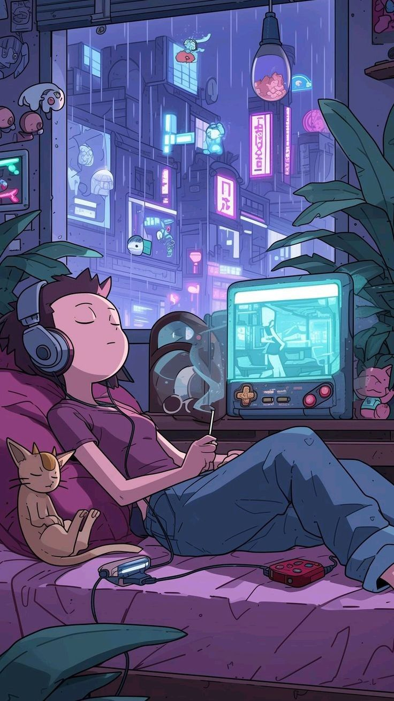

###

  
  

    <samp>
      i'm Vedant | 22 | he/him/his
       
      i like music, cli/tui tools & more
       
      experienced in c++, Bash & Javascript
       
       
      i play minecraft, im f*ing awesome
      I develop web-apps and i use arch BTW
       
       
      currently working on overthecluster
       
       
      twt: 
      <a href="https://x.com/hiispacee">@hiispacee</a> 
      contact: 
      <a href="https://discordapp.com/users/1091575419167314030">Discord@hiispace</a> 
       
      silly projects include:
       
      <a href="https://github.com/VedantKhapre/iBefore">Chat Application with Offline chat Translation</a> 
      <a href="https://github.com/VedantKhapre/Offline-Translator">Offline Translator</a> 
      <a href="https://github.com/VedantKhapre/Bluesink">Bluetooth audio devices to play audio simultaneously</a> 
      <a href="https://github.com/VedantKhapre/Code-Quest">Code-editor & Markdown-editor</a> 
       
      Visit my site <a href="https://hivedant.in">hivedant.in</a>
       
    </samp>
  

 

###

  
  
  
  

###

  
  

###
  
  

  
    

  

  

###
